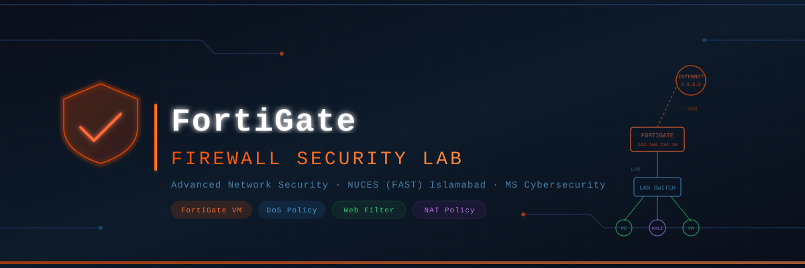

<p align="center">
  
</p>

<p align="center">
  
  
  
  
</p>

<p align="center">
  
  
  
</p>

---

## 📋 Overview

This repository documents a **comprehensive hands-on Firewall Security Lab** using **FortiGate Next-Generation Firewall (NGFW)** deployed as a virtual machine in VMware Workstation. The lab covers the full lifecycle of enterprise firewall setup — from VM deployment and interface configuration to advanced policy implementation and live attack simulation.

> **Assignment No. 2** — Advanced Network Security  
> **Student:** Muhammad Ahmad &nbsp;|&nbsp; **Roll #:** 25I-7705  
> **Instructor:** Dr. Zafar Iqbal &nbsp;|&nbsp; **Department:** Cybersecurity, NUCES Islamabad

---

## 🏗️ Lab Architecture

```
                          ┌─────────────────┐
                          │    INTERNET      │
                          │   (8.8.8.8)      │
                          └────────┬─────────┘
                                   │ WAN (port2)
                          ┌────────▼─────────┐
                          │   FORTIGATE VM   │
                          │  192.168.134.10  │
                          │  v7.6.6 (VMware) │
                          └────────┬─────────┘
                        ┌──────────┼──────────┐
                  LAN (port1)  Management   port3+
              192.168.205.0/24  192.168.134.0  (future zones)
                        │
              ┌─────────┼──────────┐
              │         │          │
        ┌─────▼──┐ ┌────▼───┐ ┌───▼────┐
        │  PC    │ │  KALI  │ │  VM    │
        │ Client │ │ Linux  │ │ Client │
        └────────┘ └────────┘ └────────┘
```

---

## 📁 Repository Structure

```
fortigate-firewall-lab/
│
├── 📄 README.md                    ← You are here
├── 📄 REPORT.md                    ← Full technical report
├── 📄 REFLECTION.md                ← Analytical reflection
├── 📄 NETWORK_TOPOLOGY.md          ← Network design details
│
├── 📂 docs/
│   ├── 01_vm_deployment.md         ← Task 1: FortiGate VM setup
│   ├── 02_gui_access.md            ← Task 2: HTTPS GUI configuration
│   ├── 03_policy_implementation.md ← Task 3: Firewall & DoS policies
│   └── 04_demonstration.md         ← Task 4: Live testing results
│
├── 📂 scripts/
│   ├── fortigate_cli_commands.txt  ← All CLI commands used
│   └── dos_test_commands.txt       ← hping3 DoS test commands
│
├── 📂 assets/
│   └── banner.svg                  ← Project banner
│
└── 📂 screenshots/
    ├── task1/                      ← VM deployment screenshots
    ├── task2/                      ← GUI access screenshots
    ├── task3/                      ← Policy configuration screenshots
    └── task4/                      ← Demonstration screenshots
```

---

## 🚀 Tasks Completed

### Task 1 — FortiGate VM Deployment
| Step | Description | Status |
|------|-------------|--------|
| 1 | Downloaded FortiGate VM image from Fortinet support portal | ✅ |
| 2 | Configured virtual network interfaces (VMnet0–VMnet12) in VMware | ✅ |
| 3 | Imported FortiGate-VM64.ovf into VMware Workstation | ✅ |
| 4 | Configured management interface (port1) via CLI | ✅ |
| 5 | Accessed FortiGate GUI via HTTPS | ✅ |
| 6 | Configured WAN (port2) and LAN (port3) interfaces with DHCP server | ✅ |
| 7 | Added default static route (0.0.0.0/0) for internet access | ✅ |

### Task 2 — GUI Access Configuration
| Step | Description | Status |
|------|-------------|--------|
| 1 | Enabled HTTPS GUI access on management port | ✅ |
| 2 | Configured administrator credentials | ✅ |
| 3 | Verified login with updated credentials | ✅ |

### Task 3 — Policy Implementation
| Policy | Type | Description | Status |
|--------|------|-------------|--------|
| `internet-access` | IPv4 Firewall | LAN → WAN, Accept + NAT | ✅ |
| `Dos-protection-policy` | IPv4 DoS | L3/L4 anomaly detection & blocking | ✅ |
| `No-Facebook-Internet-Access` | Web Filter | URL-based blocking via wildcard | ✅ |

### Task 4 — Demonstration
| Test | Tool | Result |
|------|------|--------|
| facebook.com blocked | Browser (Kali Linux) | ✅ Blocked (UTM Denied) |
| SYN Flood attack | `hping3` flood mode | ✅ Detected & Dropped |
| Traffic logs | FortiGate Log & Report | ✅ All events logged |

---

## ⚙️ VM Hardware Configuration

| Resource | Specification |
|----------|--------------|
| **RAM** | 2 GB |
| **HDD** | 30 GB (SCSI) |
| **vCPUs** | 1 |
| **NICs** | 6 virtual NICs |
| **NIC 1 (port1)** | Host-only — Management (192.168.134.0/24) |
| **NIC 2 (port2)** | Custom VMnet2 — WAN (192.168.118.0/24) |
| **NIC 3 (port3)** | Custom VMnet11 — LAN (192.168.205.0/24) |
| **NIC 4 (port4)** | Custom VMnet3 |
| **NIC 5 (port5)** | Custom VMnet4 |
| **NIC 6 (port6)** | Custom VMnet12 |

---

## 🔧 Key CLI Commands

```bash
# View all interfaces
get system interface

# Configure management interface
config system interface
  edit port1
    set mode static
    set ip 192.168.139.131 255.255.255.0
    set allowaccess http https telnet ssh ping
  end

# Verify interface configuration
show system interface

# Test connectivity
execute ping 192.168.139.131
execute ping 8.8.8.8
execute ping google.com
```

---

## 🛡️ DoS Policy — Anomaly Thresholds

### L3 Anomalies
| Anomaly | Action | Threshold |
|---------|--------|-----------|
| `ip_src_session` | Block | 5000 |
| `ip_dst_session` | Block | 5000 |

### L4 Anomalies
| Anomaly | Action | Threshold |
|---------|--------|-----------|
| `tcp_syn_flood` | Block | 2000 |
| `tcp_port_scan` | Block | 1000 |
| `udp_flood` | Block | 2000 |
| `udp_scan` | Block | 2000 |
| `icmp_flood` | Block | 250 |
| `icmp_sweep` | Block | 100 |
| `sctp_flood` | Block | 2000 |

---

## 💣 DoS Simulation Command

```bash
# SYN Flood attack using hping3 (Kali Linux)
sudo hping3 -c 15000 -d 120 -S -w 64 -p 80 --flood --rand-source 192.168.205.2

# Result: 960,735+ packets transmitted — 0 received — 100% packet loss
# FortiGate DoS policy successfully blocked all flood packets
```

---

## 🌐 Web Filter Policy

- **URL:** `facebook.com`
- **Type:** Wildcard
- **Action:** Block
- **Profile:** `default` Web Filter Profile
- **Policy Name:** `No-Facebook-Internet-Access`
- **Result:** All HTTPS requests to facebook.com denied with UTM Block

---

## 📊 Test Results Summary

```
┌─────────────────────────────────────────────────────────┐
│                   SECURITY TEST RESULTS                 │
├──────────────────────┬──────────────┬───────────────────┤
│ Test                 │ Expected     │ Result            │
├──────────────────────┼──────────────┼───────────────────┤
│ Internet Ping        │ Success      │ ✅ 0% packet loss  │
│ Google.com Ping      │ Success      │ ✅ 0% packet loss  │
│ Facebook Access      │ Blocked      │ ✅ UTM Blocked     │
│ SYN Flood (hping3)   │ Blocked      │ ✅ 100% dropped   │
│ GUI HTTPS Access     │ Accessible   │ ✅ Login verified  │
│ DoS Log Events       │ Logged       │ ✅ 98 events       │
└──────────────────────┴──────────────┴───────────────────┘
```

---

## 📚 Key Learnings

- **Virtual Network Segmentation** — Proper VMware vnet configuration is prerequisite for firewall traffic isolation
- **Out-of-Band Management** — Dedicated management interface ensures firewall accessibility during policy errors
- **Policy Ordering** — FortiGate evaluates policies top-down; rule sequence is critical to security posture
- **Defence-in-Depth** — Layered controls (stateful inspection + DoS + URL filter) provide multi-vector protection
- **Threshold Tuning** — DoS anomaly thresholds must balance security sensitivity against false positive rate

---

## 🔭 Future Exploration

- [ ] SSL/TLS Deep Inspection
- [ ] IPS Signature Tuning
- [ ] SD-WAN Integration
- [ ] FortiAnalyzer Integration
- [ ] IPSec VPN Configuration
- [ ] VLAN Segmentation & Inter-VLAN Routing

---

## 📖 References

- [Fortinet Documentation Portal](https://docs.fortinet.com)
- [FortiGate VM Deployment Guide](https://docs.fortinet.com/document/fortigate/7.6.0/vm-install-guide)
- [FortiGate CLI Reference](https://docs.fortinet.com/document/fortigate/7.6.0/cli-reference)
- [Fortinet Support Portal (VM Downloads)](https://support.fortinet.com/support/#/downloads/vm)

---

## 👤 Author

**Muhammad Ahmad**  
Roll # 25I-7705 | MS Cybersecurity  
NUCES (FAST) — Islamabad  
Course: Advanced Network Security | Instructor: Dr. Zafar Iqbal

---

<p align="center">
  <i>Built with 🔒 for Advanced Network Security — NUCES (FAST) Islamabad</i>
</p>
